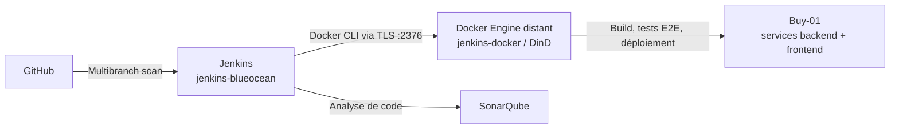

# Jenkins — Pipeline CI/CD

Ce document décrit le pipeline réellement défini dans [`Jenkinsfile`](./Jenkinsfile)
et son infrastructure Docker Compose située dans [`jenkins-setup/`](./jenkins-setup/).

## Architecture



Jenkins et le moteur Docker sont deux conteneurs distincts :

| Conteneur | Rôle |
|---|---|
| `jenkins-blueocean` | Jenkins, Docker CLI, Java 21, Node.js, Chromium et plugins |
| `jenkins-docker` | Daemon Docker-in-Docker qui construit et exécute les conteneurs Buy-01 |
| `sonarqube` | Serveur d’analyse de code, accessible à Jenkins sur `http://sonarqube:9000` |

Le CLI Docker communique avec DinD par TLS sur `docker:2376`. Les variables
`DOCKER_HOST`, `DOCKER_CERT_PATH` et `DOCKER_TLS_VERIFY` sont configurées dans
[`jenkins-setup/docker-compose.yml`](./jenkins-setup/docker-compose.yml).

## Démarrer l’infrastructure Jenkins

Le fichier Compose attend les valeurs de configuration et credentials déclarés
dans [`jenkins-casc.yaml`](./jenkins-setup/jenkins/jenkins-casc.yaml). Configurez
ces valeurs dans l’environnement de lancement ou dans un fichier `.env` local
non versionné. Ne commitez ni secrets ni clés.

Depuis la racine du dépôt :

```bash
docker compose -f jenkins-setup/docker-compose.yml up --build -d
```

Accès locaux :

| Service | URL |
|---|---|
| Jenkins | `http://localhost:8080` |
| SonarQube | `http://localhost:9000` |

Jenkins est configuré en multibranch : la découverte GitHub est périodiquement
relancée et le dépôt configure la découverte des branches et des Pull Requests.
La configuration présente ne crée pas elle-même de tunnel Ngrok.

## Étapes du pipeline

Le pipeline utilise `IMAGE_TAG=build-${BUILD_NUMBER}`, désactive les exécutions
concurrentes, conserve les stashes récents et applique un timeout global de
30 minutes.

1. **Checkout** — récupère la révision sélectionnée par le job multibranch.
2. **Prepare Secrets** — écrit les clés JWT, les certificats TLS et la
   configuration Cloudinary à partir des credentials Jenkins via
   [`scripts/prepare-secrets.sh`](./scripts/prepare-secrets.sh).
3. **Backend Unit & Integration Tests** — lance `./mvnw clean test` en parallèle
   pour les sept services backend.
4. **Backend SonarQube Analysis** — analyse les sept services et attend leur
   Quality Gate.
5. **Frontend Unit & Integration Tests** — exécute `npm ci`, puis les tests
   Angular avec la couverture activée.
6. **Frontend SonarQube Analysis** — analyse le frontend et attend son Quality
   Gate.
7. **Docker Build** — construit les images backend et frontend, puis conserve
   le tag de build pour les étapes suivantes.
8. **End-to-End Tests** — exécute [`scripts/e2e-tests.sh`](./scripts/e2e-tests.sh)
   avec les conteneurs construits. Le script attend que le Gateway réponde, lance
   Playwright et supprime les données créées par le test, y compris si le test
   échoue.
9. **Deploy Backend**, **Deploy Frontend**, **cleanUp** — exécutés uniquement
   sur la branche `main`. Les étapes de déploiement utilisent les scripts de
   déploiement et de rollback du dossier `scripts/`.

Si une étape échoue, Jenkins arrête les étapes suivantes. Les rapports JUnit
disponibles sont publiés à la fin du build et le pipeline envoie un courriel de
succès ou d’échec.

## Tests E2E dans DinD

Le script E2E démarre d’abord la stack backend, puis le frontend avec le même
`IMAGE_TAG`. Le test utilise les adresses locales HTTPS :

- Frontend : `https://localhost:4200`
- API Gateway : `https://localhost:8888`

Ces ports sont publiés par les Compose applicatifs sur le conteneur DinD. Le
script récupère l’adresse DNS `docker` et la transmet comme
`E2E_DOCKER_HOST_IP`. Playwright configure Chromium pour résoudre `localhost`
vers cette adresse, afin de conserver les URL HTTPS configurées dans
l’application.

Le pipeline n’utilise plus de script TCP proxy. Une erreur
`ERR_CONNECTION_REFUSED` doit donc être diagnostiquée en vérifiant le healthcheck
du frontend et la publication des ports `4200` et `8888` par DinD.

## Credentials Jenkins

La configuration JCasC déclare les credentials nécessaires au pipeline :

- GitHub et SMTP
- Credentials administrateur Jenkins
- MongoDB et mot de passe TLS
- URL Cloudinary
- Clés JWT privée et publique
- Certificat et clé TLS du frontend
- Token SonarQube

Le token SonarQube est référencé par l’installation Jenkins nommée `SonarQube`.
Ne stockez pas les valeurs réelles dans les fichiers suivis par Git.

## Journaux et commandes de diagnostic

```bash
docker compose -f jenkins-setup/docker-compose.yml ps
docker compose -f jenkins-setup/docker-compose.yml logs -f jenkins-blueocean
docker compose -f jenkins-setup/docker-compose.yml logs -f sonarqube
docker exec jenkins-docker docker ps
docker exec jenkins-docker docker info
```

Arrêt de l’infrastructure sans supprimer les données persistantes :

```bash
docker compose -f jenkins-setup/docker-compose.yml down
```

La suppression des volumes détruit les données Jenkins, SonarQube et les
certificats DinD ; ne la faites que si cette perte de données est voulue.
