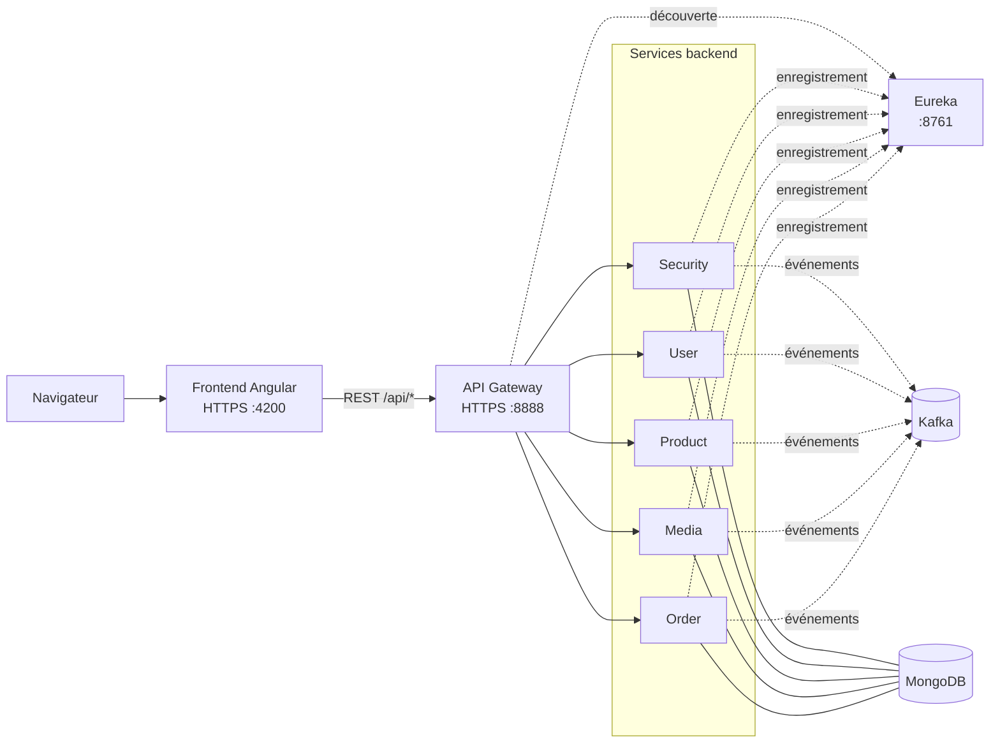

# Buy-01 — Plateforme e-commerce en microservices

Buy-01 est une application e-commerce construite avec Angular et des
microservices Spring Boot. L’API Gateway est le point d’entrée HTTP(S), Eureka
permet la découverte des services, MongoDB stocke leurs données et Kafka
transporte les événements asynchrones.

## Architecture



Les services backend communiquent aussi par événements Kafka. Les topics
configurés comprennent `authTopic`, `userTopic`, `productTopic` et `mediaTopic`.
Le [README backend](./backend/README.md) décrit les flux entre topics et services.

## Structure du dépôt

```text
backend/                 Services Spring Boot et Docker Compose
frontend/                Application Angular et tests Playwright
jenkins-setup/           Docker Compose, configuration Jenkins et SonarQube
scripts/                 Préparation des secrets, E2E et déploiement
Jenkinsfile              Pipeline CI/CD
Mr-Jenkins.md            Guide de l’infrastructure et du pipeline Jenkins
Mr-SonarQube.md          Guide de l’analyse SonarQube
```

## Stack technique

- **Backend :** Java 17, Spring Boot, Spring Cloud Gateway, Eureka, Spring
  Security, Spring Data MongoDB
- **Communication asynchrone :** Apache Kafka
- **Frontend :** Angular, TypeScript, Karma/Jasmine et Playwright
- **Données :** MongoDB et Cloudinary pour les médias
- **CI/CD :** Jenkins, Docker-in-Docker, Docker Compose et SonarQube

## Prérequis

- Docker et Docker Compose
- Pour développer le frontend localement : Node.js et npm
- Pour lancer des services Java localement : Java 17
- Les credentials, clés et certificats nécessaires à l’application

Ne placez pas de secrets réels dans les fichiers suivis par Git.

## Démarrage local

1. Configurez les variables Compose et les clés/certificats requis. Les
   paramètres backend sont documentés dans le [README backend](./backend/README.md).
2. Démarrez les services backend :

   ```bash
   cd backend
   docker compose up --build -d
   ```

3. Depuis un autre terminal, démarrez le frontend conteneurisé :

   ```bash
   cd frontend
   docker compose up --build -d
   ```

4. Ouvrez `https://localhost:4200`. Le certificat de développement peut être
   auto-signé. L’API Gateway est accessible sur `https://localhost:8888` et
   Eureka sur `http://localhost:8761`.

Le Compose backend publie Gateway, Eureka et Kafka sur l’hôte. MongoDB et les
services applicatifs restent internes au réseau Docker ; le frontend passe par
la Gateway pour appeler leurs API.

Pour vérifier l’état des conteneurs et consulter leurs logs :

```bash
docker compose ps
docker compose logs -f
```

## Tests

Tests backend d’un service :

```bash
cd backend/product-service
./mvnw clean test
```

Tests unitaires frontend :

```bash
cd frontend
npm ci
npm test -- --watch=false --include='src/**/*.spec.ts'
```

Tests E2E : le backend et le frontend doivent être démarrés avant le test.

```bash
cd frontend
npx playwright install chromium
npm run e2e
```

Le test E2E vérifie l’inscription d’un vendeur, sa connexion et la création
d’un produit. Le pipeline Jenkins lance le scénario avec les conteneurs
construits et supprime les données créées par le test.

## CI/CD et qualité

Le pipeline Jenkins teste les sept services backend, exécute les tests frontend,
analyse les huit projets avec SonarQube, construit les images et lance le test
E2E. Les étapes de déploiement backend/frontend ne s’exécutent que sur `main`.

- [Guide Jenkins](./Mr-Jenkins.md)
- [Guide SonarQube](./Mr-SonarQube.md)

## Arrêt des services

Depuis chacun des dossiers Compose concernés :

```bash
docker compose down
```

L’ajout de `-v` supprime également les volumes et les données persistantes.
