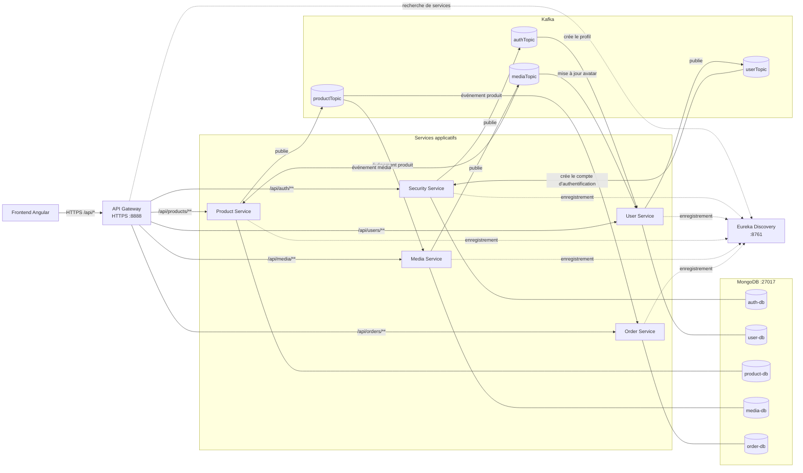

# Backend

Le backend est composé de services Spring Boot conteneurisés avec Docker Compose.
L'API Gateway distribue les requêtes vers les services enregistrés dans Eureka.
MongoDB stocke les données et Kafka transporte les événements entre certains services.

## Prérequis

- Docker avec le plugin Docker Compose (`docker compose`)
- Les valeurs de configuration MongoDB et TLS décrites ci-dessous
- Les certificats et fichiers de configuration secrets attendus par les services

Depuis le dossier `backend`, créez un fichier `.env` (ne le commitez pas) contenant :

```dotenv
MONGO_USERNAME=...
MONGO_PASSWORD=...
SSL_PASSWORD=...
```

`SSL_PASSWORD` doit correspondre au mot de passe du keystore TLS de l'API Gateway.
Les clés JWT et la configuration Cloudinary doivent également être présentes dans
les ressources des services concernés avant leur construction.

## Démarrer les services

Depuis le dossier `backend` :

```bash
docker compose up --build -d
```

Pour attendre que les healthchecks passent :

```bash
docker compose up -d --wait --wait-timeout 420
```

Afficher l'état des conteneurs et leurs healthchecks :

```bash
docker compose ps
```

`healthy` signifie que le healthcheck configuré pour le conteneur répond. Cela ne
garantit pas que chaque route de l'API Gateway fonctionne ou que chaque service est
déjà enregistré dans Eureka.

## Services et accès

| Service | Port dans le réseau Docker | Accès depuis l'hôte |
|---|---:|---:|
| API Gateway (HTTPS) | 8888 | `https://localhost:8888` |
| Eureka Discovery | 8761 | `http://localhost:8761` |
| Kafka | 9092 | `localhost:9092` |
| Security, User, Product, Media, Order | 8080 chacun | Interne à Docker |
| MongoDB | 27017 | Interne à Docker |

Les services applicatifs sont accessibles au frontend via l'API Gateway. Les
routes configurées sont :

| Préfixe | Service cible |
|---|---|
| `/api/auth/**` | Security |
| `/api/users/**` | User |
| `/api/products/**` | Product |
| `/api/media/**` | Media |
| `/api/orders/**` | Order |

## Architecture et communication



Les appels du frontend vers les API sont synchrones : la Gateway sélectionne une
instance du service cible grâce à son enregistrement dans Eureka et transmet la
requête. Les échanges entre services via Kafka sont asynchrones : le producteur
publie un événement dans un topic, puis les services consommateurs le traitent.
Chaque service utilise sa propre base MongoDB logique.

Le Gateway utilise HTTPS avec un certificat pouvant être auto-signé en
développement. Avec `curl`, utilisez `-k` pour ignorer la vérification locale du
certificat, par exemple :

```bash
curl -k -i https://localhost:8888/actuator/health
```

## Journaux et diagnostic

Suivre les journaux de tous les services :

```bash
docker compose logs -f
```

Suivre un seul service :

```bash
docker compose logs -f api-gateway
docker compose logs -f discovery-service
docker compose logs -f product-service
```

En cas de réponse `503` de la Gateway :

1. Vérifiez que le service cible est `healthy` avec `docker compose ps`.
2. Ouvrez `http://localhost:8761` et confirmez que le service apparaît dans
   Eureka.
3. Consultez les journaux de `api-gateway`, `discovery-service` et du service
   cible.
4. Vérifiez que l'URL demandée correspond à l'un des préfixes configurés
   ci-dessus.

## Arrêter les services

```bash
docker compose down
```

Les données MongoDB restent dans le volume `mongodb_data`. Pour supprimer aussi
les données persistantes, utilisez `docker compose down -v` ; cette commande
efface les données de la base.
